# System Architecture & UML Class Diagram
## Project: Shadow Assassin (2D Stealth Game in C++17)

---

## 1. Unified Modeling Language (UML) Class Diagram

The following Mermaid diagram accurately reflects the object-oriented class architecture, inheritance hierarchies, composition lifetimes, and functional associations implemented in **Shadow Assassin**:

```mermaid
classDiagram
    %% Abstract Entities & Inheritance
    class Entity {
        <<abstract>>
        #Vector2 m_position
        #Vector2 m_size
        #bool m_active
        #Color m_color
        +update(float deltaTime)* void
        +draw()* void
        +getPosition() Vector2
        +setPosition(Vector2 pos) void
        +getSize() Vector2
        +setSize(Vector2 size) void
        +getCenter() Vector2
        +getBounds() Rectangle
        +distanceTo(Entity other) float
        +isActive() bool
        +setActive(bool active) void
    }

    class Player {
        -int m_health
        -int m_maxHealth
        -float m_speed
        -Vector2 m_velocity
        -float m_facingAngle
        -int m_coinCount
        -int m_eliminationCount
        -float m_assassinationTimer
        -float m_hitFlashTimer
        +update(float deltaTime) void
        +draw() void
        +handleInput() void
        +moveAndSlide(float dt, vector~Obstacle~ obstacles, float w, float h) void
        +canAssassinate(Vector2 targetPos, float targetAngle, float maxDist, float rearTol) bool
        +isBehindTarget(Vector2 targetPos, float targetAngle, float rearTol) bool
        +takeDamage(int amount) void
        +heal(int amount) void
        +resetHealth() void
        +addCoins(int amount) void
        +addElimination() void
    }

    class Enemy {
        <<abstract>>
        #int m_health
        #int m_maxHealth
        #float m_speed
        #float m_facingAngle
        +update(float deltaTime)* void
        +draw()* void
        +takeDamage(int amount) void
        +onAlerted(Vector2 targetPos) void
        +attack() void
        +getHealth() int
        +isAlive() bool
    }

    class Guard {
        -GuardState m_state
        -float m_stateTimer
        -float m_searchDuration
        -vector~Vector2~ m_patrolPoints
        -size_t m_currentWaypointIndex
        -float m_patrolSpeed
        -float m_chaseSpeed
        -float m_visionRadius
        -float m_visionAngle
        -float m_attackCooldown
        -int m_attackDamage
        -Vector2 m_lastKnownPlayerPos
        +update(float deltaTime) void
        +draw() void
        +updateAI(float dt, Player player, vector~Obstacle~ obstacles, float w, float h) void
        +canSeePlayer(Player player, vector~Obstacle~ obstacles) bool
        +isVulnerableTo(Player player, float maxDist, float rearTol) bool
        +addPatrolPoint(Vector2 point) void
        +eliminate() void
    }

    class Obstacle {
        -Rectangle m_bounds
        -bool m_blocksVision
        -Color m_color
        +getBounds() Rectangle
        +contains(Vector2 point) bool
        +collidesWithCircle(Vector2 center, float radius) bool
        +collidesWithRect(Rectangle other) bool
        +blocksVision() bool
        +draw() void
    }

    class Collectible {
        -Vector2 m_position
        -float m_radius
        -int m_value
        -bool m_isCollected
        -float m_animTimer
        +checkCollision(Vector2 entityCenter, float radius) bool
        +collect() void
        +reset() void
        +update(float deltaTime) void
        +draw() void
    }

    class CollisionManager {
        <<utility>>
        +checkCircleRect(Vector2 center, float radius, Rectangle rect)$ bool
        +resolveCircleRect(Vector2 center, float radius, Rectangle rect)$ Vector2
        +resolveMovement(Vector2 center, Vector2 velocity, float radius, float dt, vector~Obstacle~ obstacles)$ Vector2
        +clampToMapBounds(Vector2 center, float radius, float minX, float minY, float maxX, float maxY)$ Vector2
        +checkLineOfSight(Vector2 start, Vector2 end, vector~Obstacle~ obstacles)$ bool
        +checkLineIntersection(Vector2 a1, Vector2 a2, Vector2 b1, Vector2 b2, Vector2 hitPoint)$ bool
    }

    class CharacterRenderer {
        <<utility>>
        -Texture2D s_playerTexture$
        -Texture2D s_guardTexture$
        -Texture2D s_shadowTexture$
        -Texture2D s_bloodTexture$
        -bool s_loaded$
        +init()$ void
        +shutdown()$ void
        +isLoaded()$ bool
        +drawPlayer(...)$ void
        +drawGuard(...)$ void
        +drawGroundShadow(Vector2 center, float radius, float stretch)$ void
        +drawBloodSplatter(Vector2 center, float radius)$ void
        +drawAssassinationSlash(...)$ void
    }

    class Level {
        -int m_levelNumber
        -string m_name
        -string m_description
        -Vector2 m_playerSpawn
        -float m_mapWidth
        -float m_mapHeight
        -vector~Obstacle~ m_obstacles
        -vector~unique_ptr~Guard~~ m_guards
        -vector~Collectible~ m_coins
        +load(int levelNumber) void
        +reset() void
        +update(float deltaTime, Player player) void
        +draw() void
        +areAllGuardsEliminated() bool
        +areAllCoinsCollected() bool
        +getRemainingGuardsCount() int
    }

    class UIManager {
        -int m_screenWidth
        -int m_screenHeight
        -vector~UINotification~ m_notifications
        +drawHUD(int levelNum, string name, int hp, int maxHp, int coins, int totalCoins, int remGuards, int totalGuards, int elims, int fps) void
        +drawMainMenu(Vector2 mousePos, bool clicked, bool showControls) UIAction
        +drawPauseMenu(Vector2 mousePos, bool clicked, int currentLevel) UIAction
        +drawLevelComplete(...) UIAction
        +drawGameOver(...) UIAction
        +drawVictory(...) UIAction
        +drawButton(...)$ bool
        +addNotification(string text, Vector2 pos, Color col, float lifetime) void
        +update(float deltaTime) void
    }

    class GameManager {
        -int m_screenWidth
        -int m_screenHeight
        -string m_title
        -bool m_isRunning
        -GameState m_currentState
        -int m_checkpointCoins
        -int m_checkpointEliminations
        -unique_ptr~Player~ m_player
        -unique_ptr~Level~ m_currentLevel
        -unique_ptr~UIManager~ m_uiManager
        +init() bool
        +run() void
        +update(float deltaTime) void
        +draw() void
        +shutdown() void
        +loadLevel(int levelNumber) void
        +advanceToNextLevel() void
        +restartCurrentLevel() void
    }

    %% Enumerations
    class GameState {
        <<enumeration>>
        MENU
        PLAYING
        PAUSED
        LEVEL_COMPLETE
        GAME_OVER
        VICTORY
    }

    class GuardState {
        <<enumeration>>
        PATROLLING
        ALERTED
        CHASING
        ATTACKING
        DEAD
    }

    class UIAction {
        <<enumeration>>
        NONE
        START_GAME
        RESUME_GAME
        NEXT_LEVEL
        RESTART_LEVEL
        SHOW_CONTROLS
        HIDE_CONTROLS
        MAIN_MENU
        EXIT_GAME
    }

    %% Inheritance Relationships
    Entity <|-- Player : Single Inheritance
    Entity <|-- Enemy : Hierarchical Inheritance
    Enemy <|-- Guard : Multilevel Inheritance

    %% Composition Relationships (Strict Lifetime Ownership)
    Level *-- Obstacle : owns multiple
    Level *-- Guard : owns unique_ptr
    Level *-- Collectible : owns multiple
    GameManager *-- Player : owns unique_ptr
    GameManager *-- Level : owns unique_ptr
    GameManager *-- UIManager : owns unique_ptr

    %% Associations & Dependencies
    GameManager ..> GameState : manages
    Guard ..> GuardState : state machine
    UIManager ..> UIAction : returns
    Player ..> CollisionManager : uses static solver
    Guard ..> CollisionManager : uses static raycast
    Player ..> CharacterRenderer : renders sprite via
    Guard ..> CharacterRenderer : renders sprite via
    GameManager ..> CharacterRenderer : manages lifecycle
    Level ..> Player : updates interactions with
    GameManager ..> CollisionManager : boundary clamping
```

---

## 2. Architectural Analysis of Class Relationships

### A. Inheritance Relationships
1. **`Entity` $\to$ `Player` (Single Inheritance)**:
   - `Player` specializes `Entity`. It inherits basic spatial coordinates (`m_position`, `m_size`), distance calculation methods, and base bounding box queries. It adds player-controlled inputs, speed, health systems, and assassination mechanisms.
2. **`Entity` $\to$ `Enemy` $\to$ `Guard` (Multilevel Inheritance)**:
   - `Enemy` derives from `Entity`, introducing combat statistics (`m_health`, `m_speed`) and declaring virtual combat hooks (`onAlerted`, `attack`).
   - `Guard` derives from `Enemy`, fulfilling all remaining pure virtual contracts and adding the 5-state AI Finite State Machine, waypoint paths, vision cones, and line-of-sight queries.

### B. Composition Relationships (Strict Lifecycle Ownership)
1. **`Level` Composition**:
   - `Level` holds value-owned vectors of `Obstacle` (`std::vector<Obstacle>`) and `Collectible` (`std::vector<Collectible>`).
   - `Level` holds dynamic heap-allocated `Guard` instances via exclusive smart pointers (`std::vector<std::unique_ptr<Guard>>`).
   - **Lifecycle Guarantee**: Destroying a `Level` instance automatically destroys all owned walls, coins, and guards without manual iteration or risk of leaks.
2. **`GameManager` Composition**:
   - `GameManager` strongly owns the active `Player` (`std::unique_ptr<Player>`), active `Level` (`std::unique_ptr<Level>`), and presentation layer (`std::unique_ptr<UIManager>`).
   - Enforces the **Mediator Pattern**: Subsystems communicate through `GameManager` rather than creating tight circular dependencies between each other.

### C. Static Utility Associations (Decoupled Math Solvers)
1. **`CollisionManager`**:
   - Completely stateless. Contains only static member functions.
   - Both `Player` (for wall sliding) and `Guard` (for line-of-sight raycasting and obstacle avoidance) call `CollisionManager` methods without creating or storing class instances.
   - Upholds the **Single Responsibility Principle (SRP)** by isolating physics math from entity behavioral logic.

### D. Presentation & Decoupling (`UIManager`)
1. **`UIManager`**:
   - Isolates the user interface from simulation mechanics.
   - Communicates with `GameManager` via strongly typed `UIAction` enum values (`START_GAME`, `RESUME_GAME`, `NEXT_LEVEL`, `RESTART_LEVEL`, `MAIN_MENU`, `EXIT_GAME`).
   - Protects automated tests with `IsWindowReady()` safeguards, allowing headless unit tests to run safely on CI/CD servers.
